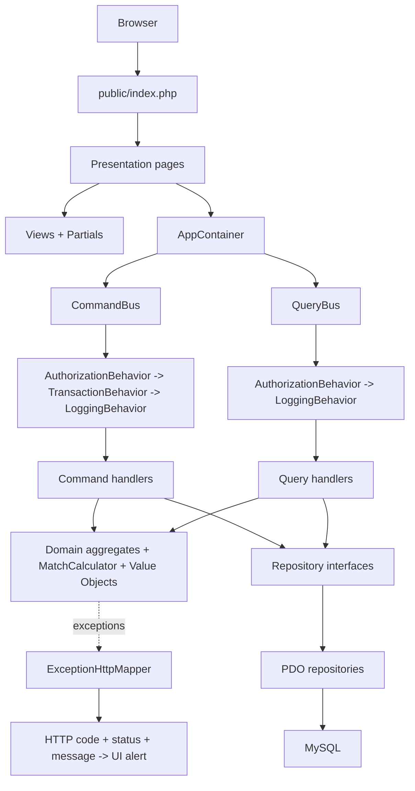

# JobVault

[](https://github.com/Aureo-Bueno/job-vault/actions/workflows/tests.yml)

Job vacancy, company, and talent matching system built with PHP + MySQL, featuring authentication, role/permission-based access control, candidate profiles, company-scoped recruitment, and a two-sided compatibility engine.

## Overview
This project provides:
- **Vacancy CRUD & Topic Tagging** — vacancies include work area, seniority, work mode, normalized topic/skill tags, number of positions, and belong to a company
- **Employment Terms** — contract type (CLT, PJ, Estágio, Temporário, Freelancer), optional monthly salary range ("A combinar" when empty), city/UF (required for on-site and hybrid), free-form benefit tags and an optional application deadline
- **Full-text Search** — the company panel and the candidate list search title, description, topics and benefits with a MySQL `FULLTEXT` index (accent-insensitive, every word required, prefix match), rank results by relevance and update while typing
- **Vacancy Lifecycle** — `rascunho` (draft, only the company sees it) → `aberta` (accepts applications) ⇄ `encerrada` (closed manually, when the last position is filled in the pipeline, or by the scheduler when the deadline passes); a published vacancy never goes back to draft
- **Companies & Multi-Recruiter Accounts (`1:N`)** — self-registration as Candidate or Company, company profile management, and company-level isolation so recruiters manage only their own company's vacancies (while admins manage all)
- **Candidate Profiles** — professional headline, bio, primary work area, seniority level, preferred work mode, social/portfolio links (LinkedIn, GitHub), and interactive topic/skill tags
- **Hiring Pipeline** — applications move through `recebida → em análise → entrevista → aprovada` (one stage at a time) or `reprovada` (with optional feedback to the candidate, can be reopened). Recruiters work on a Kanban board per vacancy with full history and internal notes; candidates follow their applications in "Minhas candidaturas", can withdraw while in process and apply again while the vacancy is open
- **Two-Sided Compatibility Matching (`MatchCalculator`)**:
  - **Candidate side:** open vacancies show a `0–100%` match score, highlight matched topic tags in green, and can be filtered/sorted by best match
  - **Company / Admin side:** applicants per vacancy are ranked from highest to lowest `% match`, showing their bio, matched vs. missing topics, and direct contact/profile links
- **User, Role & Permission Administration** — tabbed admin workspace for users, companies, roles, and permissions
- **Command & Query Buses** with a behavior pipeline (authorization, transaction, logging)
- **Centralized Exception-to-HTTP/Status Mapping** for consistent UI feedback
- **Responsive Dark-Mode App Shell** — sidebar layout, mobile offcanvas navigation, stacked mobile tables, and external CSS/JS assets (`public/assets/css/app.css`, `public/assets/js/app.js`)

## Structure and architecture
Layered (Clean Architecture / DDD-inspired). Dependencies only point inwards:
`Presentation -> Application -> Domain` and `Infrastructure -> Application/Domain`.

- `app/Domain` - pure PHP, no framework/SQL/HTTP:
  - `Vacancy/` - `Vacancy` (publish, revise, `open()`/`close(reason)`/`closeIfFilled()`, company ownership, topics, positions, `receiveApplicationFrom()`), `VacancyStatus` (rascunho/aberta/encerrada), `VacancyCloseReason`, `VacancyPositions`, `EmploymentTerms` (`ContractType`, `SalaryRange`, `VacancyLocation`, `Benefit`), `VacancyDeadline`, `VacancyTitle`, `VacancyDescription`, `VacancyFilter`
  - `Company/` - `Company` (corporate identity, sector, website, description), `CompanyId`, `CompanyName`, `CompanyRepositoryInterface`
  - `CandidateProfile/` - `CandidateProfile` (headline, bio, area, seniority, work mode, links, normalized topic tags), `CandidateProfileRepositoryInterface`
  - `Matching/` - `MatchCalculator` (pure domain service scoring candidate vs. vacancy compatibility `0..100%`) and `MatchResult`
  - `JobApplication/` - `JobApplication` (created only through an open vacancy; `advance()`, `reject()`, `reopen()`, `withdraw()`, `resubmit()` with full history), `ApplicationStatus` (stages and transition table), `ApplicationEvent`, `ApplicationNote`, `InvalidApplicationTransitionException`, `AlreadyAppliedException`
  - `User/` - `User` (register, verifyPassword, changeProfile, changePassword, assignRole, assignCompany), `EmailAddress`, `PersonName`, `PlainPassword`, `PasswordHash`, `UserFilter`
  - `Role/` - `Role` (rename guard for admin, grant/revoke permissions, `ensureCanBeDeleted()`), `RoleName`
  - `Permission/` - `Permission`, `PermissionName` (`module.action` composition/normalization)
  - `Shared/` - typed ids (`AbstractId`), `WorkArea`, `Seniority`, `WorkMode`, `TopicTag` (slug normalization & alias deduplication), `PageRequest`, `SearchTerm`; `Exception/` - domain exceptions
  - Repository interfaces live next to their aggregate and expose intent methods (`matching(filter, page)`), never SQL.
- `app/Application` - use cases:
  - `Commands/`, `Queries/`, `Features/` (one handler per use case for `Users`, `Companies`, `Profile`, `Vacancies`, `Applications`, `Roles`, `Permissions`, `RolePermissions`)
  - `Features/Vacancies/VacancyAccessScope` - enforces company-level isolation for non-admin recruiters
  - `Security/` - `Authorization` (role -> permissions, cached per request), `MessageAuthorizer` (the single enforcement point deciding if a command/query can run), `CurrentUserProvider`
  - `Auth/AuthService` - login/logout and candidate or company self sign-up, no HTTP (`header()`/`exit` stay in Presentation)
  - `Users/UserRegistrar` - unique e-mail, default role, and company account creation policy
  - `Ports/` - `SessionInterface`, `LoggerInterface` implemented by Infrastructure
  - `DTOs/` - read models returned to the UI (`VacancyDto`, `VacancyApplicantDto`, `CandidateProfileDto`, `CompanyDto`, `UserDto`, `RoleDto`, `PermissionDto`, `PagedResult`)
- `app/Infrastructure` - `Persistence/` (PDO `Database` wrapper with nested transactions via SAVEPOINT + repositories for users, companies, candidate profiles, vacancies, applications, roles, permissions; `Migrations/` runner), `Http/NativeSession`, `Logging/FileLogger`, `Container/AppContainer` (composition root)
- `database/migrations` - versioned schema + seed migrations; `bin/migrate` - migrations CLI
- `app/Presentation` - `pages/` (thin controllers), `views/` (`layout/`, `pages/`, `partials/`), `Support/` (`PageAccess`, `Layout`, `Csrf`, `HttpRedirect`, `Pagination`, `ExceptionHttpMapper`, `StatusAlertMapper`)
- `public/` - `index.php` (front controller routing via `?r=`), `assets/css/app.css` (design system), `assets/js/app.js` (password toggle, topic chip picker, account-type switch, validation, confirmations)

## Architecture diagram


## Methodologies and patterns
- Rich domain model: business rules and compatibility scoring live in aggregates, domain services, and value objects
- CQRS-lite: commands change state, queries return DTOs/`PagedResult`
- Ports & adapters for session, logging, and persistence
- Single authorization enforcement point in the bus pipeline + company ownership scoping
- Exception-driven error flow with centralized HTTP/status mapping

## Hiring pipeline
| Stage | Recruiter can | Candidate can |
|---|---|---|
| `recebida` | advance to *em análise*, reject | withdraw |
| `em_analise` | advance to *entrevista*, reject | withdraw |
| `entrevista` | advance to *aprovada*, reject | withdraw |
| `aprovada` | — (final) | — |
| `reprovada` | reopen (back to *em análise*) | — (sees the feedback) |
| `desistiu` | — | apply again while the vacancy is open (back to *recebida*) |

- Rules live in `ApplicationStatus::canTransitionTo()` and the `JobApplication` methods; invalid moves raise `InvalidApplicationTransitionException` (422).
- Recruiters only act on vacancies of their own company (`VacancyAccessScope`) and need `application.manage`.
- Every change is stored in `application_events` (who, when, feedback). Internal notes (`application_notes`) are never shown to candidates; the candidate's history hides who moved the application.
- Each board action sends the stage the recruiter saw; if someone else moved the card meanwhile the action fails with `409 conflict` instead of acting on stale data.
- Withdrawn applications do not count as applicants on the vacancy list.
- Approving the candidate that fills the last position closes the vacancy (`close_reason = preenchida`); the recruiter can reopen it (or raise the number of positions) from the edit form.

## Vacancy lifecycle
| Status | Visible to candidates | Accepts applications | Next |
|---|---|---|---|
| `rascunho` | no | no | publish → `aberta` (the publication date becomes now) |
| `aberta` | yes | yes | close → `encerrada` |
| `encerrada` | no | no | reopen → `aberta`; the pipeline keeps working |

Closing reasons: `manual` (recruiter), `preenchida` (all positions filled) and `prazo` (deadline passed).

### Employment terms and deadline
- **Salary**: whole reais per month, both ends optional: `R$ 8.000 – R$ 12.000`, `A partir de R$ 8.000`, `Até R$ 12.000` or `A combinar`. The candidate filter "A partir de R$ X" uses the top of the range and never matches "A combinar".
- **Location**: city + UF, required when the work mode is `presencial` or `hibrido`; optional for remote vacancies.
- **Benefits**: free tags (max 20, 60 chars each), deduplicated ignoring case and accents, stored in `vacancy_benefits`.
- **Deadline** (`closes_at`): last day to apply, until 23:59 Brasília time (`VacancyDeadline::TIMEZONE`) regardless of the server timezone. It cannot be set in the past. After it passes the vacancy disappears from the candidate list and refuses applications right away; the scheduler then closes it with reason `prazo`. Reopening such a vacancy requires a new deadline (or removing it).

## Vacancy search
Both search boxes (`index.php?r=vacancies` for the company, `index.php?r=vacancies/apply` for candidates) use full-text search.

- **What is searched**: title, description, topics and benefits, stored normalized in `vacancies.search_document` under the `FULLTEXT` index `ft_vacancies_search`. The repository rewrites it on every save. City/UF, contract and salary stay in their own filters.
- **Query**: `BOOLEAN MODE`, every word required and matched as a prefix: `php seni` → `+php* +seni*`. Operators typed by the user (`-`, `"`, `*`, `~`...) are neutralized.
- **Relevance**: InnoDB ranking over a document where the title counts 3x and topics 2x. Without a search, the panel lists newest first. For candidates, "Mais relevantes" is the text relevance when searching and the profile match otherwise; "Maior match" and "Mais recentes" are still available.
- **Normalization** (`app/Infrastructure/Persistence/Search/FullTextTokenizer.php`, same rules for documents and queries):
  - lowercase without accents (`programação` = `programacao`);
  - `C#` → `csharp`, `C++` → `cplusplus`, `.NET` → `dotnet`, `Node.js` → `nodejs`;
  - Portuguese stopwords dropped (`vaga de PHP` does not require "de");
  - words shorter than `innodb_ft_min_token_size` (3) padded with `_` so `Go`, `UI`, `R` are indexed.
- **Stopwords**: the index is created with InnoDB's English stopword list disabled (`innodb_ft_enable_stopword = OFF` during `CREATE`), so words like "about" are searchable. No server config is needed.
- **While typing**: 400 ms after the last key (min. 2 characters, or an empty box), `app.js` fetches the page with the form's query and swaps the `[data-live-region]` blocks (results, counter, "Limpar") and updates the URL, keeping focus. Without JS, Enter/Filtrar submit the form normally.
- **Reindex**: `php bin/console vacancies:reindex-search` rebuilds every document. Run it after changing the tokenizer or after inserting vacancies with raw SQL (e.g. a seed migration), which bypasses the repository.
- **Tests**: InnoDB applies full-text changes only on COMMIT, so `tests/Integration/Persistence/VacancyFullTextSearchIntegrationTest.php` writes committed rows (with a random marker word) and deletes them afterwards. The other integration tests run inside a rolled-back transaction and do not use the text search.

## Scheduler
The `scheduler` service runs `php bin/console schedule:work`, which executes the scheduled jobs on start and then every `SCHEDULER_INTERVAL` seconds (default `3600`). Jobs use a dedicated system command bus (`AppContainer::systemCommandBus()`, no logged-in user, transaction + logging to `logs/scheduler_<date>.log`).

```bash
docker compose exec php php bin/console vacancies:close-expired   # run the job once
docker compose exec php php bin/console vacancies:reindex-search  # rebuild the full-text documents
docker compose logs -f scheduler                                   # follow the worker
```

The demo seed leaves "Programador C#" open with a deadline two days in the past, so the first scheduler run closes it.

## Main routes
- `index.php?r=home` / `index.php?r=vacancies` (vacancy management panel, scoped to the recruiter's company or all companies for admins)
- `index.php?r=vacancies/new` (publish vacancy with area, seniority, work mode, topic tags, contract, salary, city/UF, benefits and deadline)
- `index.php?r=vacancies/edit&id=<uuid>` (edit vacancy)
- `index.php?r=vacancies/delete&id=<uuid>` (delete vacancy confirmation)
- `index.php?r=vacancies/applicants&id=<uuid>` (hiring pipeline board: applicants by stage, ranked by `% match`; advance, reject with feedback, reopen, history and internal notes)
- `index.php?r=vacancies/apply` (open vacancies for candidates with full-text search, `% match`, matched topic highlights, salary/contract/location/benefits, and filters by area, work mode, contract, UF and minimum salary)
- `index.php?r=applications` (candidate's applications: stage stepper, history, company feedback, withdraw / apply again)
- `index.php?r=profile` (candidate professional profile & topic tags editor)
- `index.php?r=company` (recruiter's company profile editor)
- `index.php?r=users` (admin panel with tabs: Users, Companies, Roles, Permissions)
- `index.php?r=users/new`, `index.php?r=users/edit&id=<uuid>`, `index.php?r=users/delete&id=<uuid>`
- `index.php?r=login` (sign in or sign up as Candidate or Company)
- `index.php?r=logout`

## Error handling and front feedback
Application and infrastructure errors are mapped to a normalized payload:
- `httpCode` (HTTP response code)
- `status` (URL-friendly status used by the UI)
- `message` (user-facing message)

Core mapper:
- `app/Presentation/Support/ExceptionHttpMapper.php`

Alert dictionary:
- `app/Presentation/Support/StatusAlertMapper.php`

Common statuses:
- `success`
- `error`
- `conflict`
- `not_found`
- `validation_error`
- `forbidden`
- `unauthorized`
- `db_error`
- `server_error`

Pages redirect with:
- `?status=<status>&message=<urlencoded-message>`

Database layer (`app/Infrastructure/Persistence/Exceptions`) throws dedicated exceptions:
- `DatabaseConnectionException`
- `DatabaseQueryException`

## Run with Docker
```bash
cp .env.example .env
docker compose build
docker compose up -d
```

Open: `http://localhost:8080/index.php?r=home`

> On every `up`, the one-shot `migrate` service applies pending migrations (schema + seed data)
> and exits; the `php` app and the `scheduler` worker only start after it completes successfully. The container entrypoint runs
> `composer install` and creates `logs/` on every start, so the bind-mounted project always has a complete `vendor/`.

### Rebuild from scratch (remove image and containers)
```bash
docker compose down --rmi local      # stop/remove containers, network and the project image
docker compose build --no-cache      # rebuild the image ignoring the layer cache
docker compose up -d                 # create and start fresh containers
```

To also reset the database (deletes the `mysql_data` volume; migrations rebuild it on the next `up`):
```bash
docker compose down --rmi local -v
docker compose up -d --build
```

> Without `-v` the MySQL data is kept and only pending migrations run.

Check status and logs:
```bash
docker compose ps
docker compose logs -f php
docker compose logs migrate      # output of the last migration run
```

### First admin user
The seed migrations create no admin. Sign up on the login page, then promote the account:
```bash
docker compose exec mysql mysql -uappuser -papp_password myapp_db -e \
  "UPDATE users SET role_id=(SELECT id FROM roles WHERE name='admin') WHERE email='you@example.com';"
```

## Database migrations
The database schema **and** its seed data are versioned as PHP migrations. There is no `setup.sql`:
an empty database is built entirely by running the migrations in order.

### How it works
| Piece | Location | Role |
|---|---|---|
| Migration files | `database/migrations/*.php` | One reversible change each (`up()` / `down()`) |
| Base class | `app/Infrastructure/Persistence/Migrations/Migration.php` | Contract every migration extends |
| Runner | `app/Infrastructure/Persistence/Migrations/Migrator.php` | Discovers files, applies, rolls back, locks |
| History | `schema_migrations` table (created automatically) | Which migrations ran and in which batch |
| CLI | `bin/migrate` | Command-line entry point |
| Docker job | `migrate` service in `docker-compose.yml` | Runs `php bin/migrate migrate` before the app starts |

On `docker compose up`:
1. `mysql` starts and becomes healthy.
2. The one-shot `migrate` container runs every **pending** migration and exits.
3. `php` (the app) starts only if `migrate` exited successfully. If a migration fails, the app does
   not start: check `docker compose logs migrate`.

Rules the runner follows:
- **Order** = file name order. Names start with a timestamp (`YYYY_MM_DD_HHMMSS_description.php`), so
  newer files always run after older ones.
- **Pending** = a file whose name is not in `schema_migrations`. Each one runs once per database.
- **Batch**: all migrations applied by one `migrate` call share a batch number. `rollback` reverts the
  last batch.
- **Transaction**: each migration runs in its own transaction and is recorded only on success. Data
  statements (`INSERT`/`UPDATE`/`DELETE`) are rolled back on failure. MySQL DDL (`CREATE`/`ALTER`/`DROP`)
  commits implicitly and **cannot** be rolled back (see [Troubleshooting](#troubleshooting)).
- **Lock**: a MySQL `GET_LOCK` prevents two runners from migrating at the same time.
- **Retry**: `bin/migrate` waits for MySQL to accept connections (`MIGRATE_CONNECT_RETRIES`, default 30, 1 s apart).

### Current migrations
| Migration | Type | What it does |
|---|---|---|
| `000001_create_access_control_tables` | schema | `roles`, `permissions`, `role_permissions` |
| `000002_create_companies_table` | schema | `companies` |
| `000003_create_users_table` | schema | `users` |
| `000004_create_candidate_profile_tables` | schema | `candidate_profiles`, `candidate_topics` |
| `000005_create_vacancies_tables` | schema | `vacancies`, `vacancy_topics` |
| `000006_create_applications_table` | schema | `applications` |
| `000007_seed_roles_and_permissions` | seed | Roles `admin`/`gestor`/`usuario`, 20 permissions and grants |
| `000008_seed_demo_companies` | seed | 3 demo companies |
| `000009_seed_demo_users` | seed | 2 demo users + candidate profile and topics |
| `000010_seed_demo_vacancies` | seed | 15 demo vacancies + topics |
| `000011_drop_duplicate_name_indexes` | fix | Removes duplicate `UNIQUE` indexes on `roles.name` / `permissions.name` |
| `000012_remove_on_update_from_vacancies_created_at` | fix | Publication date no longer changes on UPDATE |
| `000013_require_user_credentials_and_add_created_at` | fix | `users.name/email/password` `NOT NULL`, adds `users.created_at` |
| `000014_add_vacancy_listing_indexes` | fix | Indexes for vacancy filters and ordering |
| `000015_add_pipeline_status_to_applications` | schema | `applications.status`, `status_changed_at`, `candidate_feedback` |
| `000016_create_application_events_and_notes` | schema | `application_events` (history) and `application_notes`; backfills the initial event |
| `000017_seed_application_manage_permission` | seed | `application.manage` permission for `admin` and `gestor` |
| `000018_seed_demo_applications` | seed | 2 more demo candidates and 6 applications across the TechNova pipeline |
| `000019_replace_vacancy_is_active_with_status` | schema | `is_active` (`s`/`n`) → `status`, `close_reason`, `closed_at`, `positions` |
| `000020_seed_demo_vacancy_lifecycle` | seed | Positions on demo vacancies, one closed as filled, one draft |
| `000021_add_employment_terms_to_vacancies` | schema | `contract_type`, `salary_min/max`, `city`, `state`, `closes_at` + `vacancy_benefits` table |
| `000022_seed_demo_vacancy_terms` | seed | Contract, salary, location, benefits and deadlines (relative to the run date) for the demo vacancies |
| `000023_add_vacancy_full_text_search` | schema | `vacancies.search_document` + `FULLTEXT` index (without InnoDB stopwords), indexes existing rows |

### Commands
Run them inside the `php` container:
```bash
docker compose exec php php bin/migrate status             # list migrations: Ran (with batch) or Pending
docker compose exec php php bin/migrate                    # apply all pending migrations (same as `migrate`)
docker compose exec php php bin/migrate rollback           # revert the last batch
docker compose exec php php bin/migrate rollback --step=2  # revert the last 2 migrations
docker compose exec php php bin/migrate reset              # revert every migration (empty database)
docker compose exec php php bin/migrate fresh              # reset + migrate (rebuild from scratch)
docker compose exec php php bin/migrate help
```

> `reset` and `fresh` run every `down()`, which **deletes all data**, including seeds and anything created through the app.

Applying is also automatic: `docker compose up -d` runs pending migrations through the `migrate` service.
To re-run only that job: `docker compose run --rm migrate`.

### Creating a new migration
**1. Generate the file** (`-u` makes the file owned by your user instead of root):
```bash
docker compose exec -u "$(id -u):$(id -g)" php php bin/migrate make "add phone to users"
# Created database/migrations/2026_10_20_173305_add_phone_to_users.php
```

**2. Write `up()` and `down()`.** `down()` must undo exactly what `up()` did.

Schema change, using `exec()` for DDL:
```php
<?php

use App\Infrastructure\Persistence\Database;
use App\Infrastructure\Persistence\Migrations\Migration;

return new class extends Migration {
  public function up(Database $db): void
  {
    $db->exec('ALTER TABLE `users` ADD COLUMN `phone` varchar(30) NULL AFTER `email`');
  }

  public function down(Database $db): void
  {
    $db->exec('ALTER TABLE `users` DROP COLUMN `phone`');
  }
};
```

Seed / data change, using `run()` with bound parameters (never concatenate values into SQL):
```php
public function up(Database $db): void
{
  $db->run(
    'INSERT INTO `permissions` (`id`, `name`, `description`, `module`, `action`) VALUES (UUID(), ?, ?, ?, ?)',
    ['company.view', 'Visualizar empresas', 'company', 'view']
  );
}

public function down(Database $db): void
{
  $db->run('DELETE FROM `permissions` WHERE `name` = ?', ['company.view']);
}
```

Available `Database` methods: `exec($sql)` (DDL, no parameters), `run($sql, $params)`,
`fetchAll()`, `fetchOne()`, `fetchValue()`. To abort a migration with a clear message, throw
`App\Infrastructure\Persistence\Migrations\MigrationException` (see `000013` for a pre-check example).

**3. Apply and check that it is reversible:**
```bash
docker compose exec php php bin/migrate            # apply
docker compose exec php php bin/migrate rollback   # down() must work
docker compose exec php php bin/migrate            # up() must work again
docker compose exec -e RUN_INTEGRATION=1 php ./vendor/bin/phpunit
```

**4. Commit the migration together with the code that depends on it** (next section).

### What else to edit when the schema changes
A migration only changes the database. The code that reads and writes that table must follow in the
same commit. Example for a new column `users.phone`:

| Layer | File(s) | Change |
|---|---|---|
| Migration | `database/migrations/<timestamp>_add_phone_to_users.php` | `ALTER TABLE` in `up()`, reverse in `down()` |
| Persistence | `app/Infrastructure/Persistence/PdoUserRepository.php` | Add the column to `COLUMNS`, to the `INSERT`/`UPDATE` in `save()` and to `map()` |
| Domain | `app/Domain/User/User.php` (+ a value object if it has rules) | New property, `reconstitute()` parameter, behaviour method |
| Application | `app/Application/DTOs/UserDto.php`, `Commands/Users/*`, `Features/Users/*` | Expose and accept the field |
| Presentation | `app/Presentation/pages/users-*.php`, `views/pages/user-form.php`, `users-list.php` | Form input and display |
| Tests | `tests/Support/InMemoryUserRepository.php`, `tests/Unit/...`, `tests/Integration/Persistence/PdoRepositoriesIntegrationTest.php` | Cover the new field |

The same applies to every table, through its `Pdo*Repository` (`PdoVacancyRepository`,
`PdoCompanyRepository`, `PdoCandidateProfileRepository`, ...). Each repository lists its columns
explicitly, so a new column is ignored until the repository uses it, and a renamed or removed column
breaks the queries that still use the old name.

Other cases:
- **New table**: a migration plus a repository interface in `app/Domain/<Aggregate>/`, a `Pdo*Repository` in
  `app/Infrastructure/Persistence/`, wiring in `app/Infrastructure/Container/AppContainer.php`, and an in-memory fake in `tests/Support/`.
- **New permission**: a seed migration that inserts it into `permissions` and grants it in `role_permissions`
  (see `000007`), plus the check that uses it in the application layer.
- **Vacancy text fields** (title, description, topics, benefits): they feed `search_document`. A seed migration that
  inserts vacancies with raw SQL must end with `(new VacancySearchIndexer($db))->reindexAll()`, or they will not be found.
- **Rename or drop a column**: update every repository query that uses the column, and make `down()` restore it.
  Dropped column data cannot be brought back by `down()`.

### Rules
- **Never edit a migration that has already run** on another machine or environment: create a new one that
  changes it. Edited files are not re-run, because the name is already in `schema_migrations`.
- **One change per migration**, especially for DDL, so a failure leaves at most one step to fix by hand.
- **Always write `down()`** and test it with `rollback`.
- **Seed migrations delete only what they inserted** (by fixed id, e-mail or name), never `DELETE FROM table`.
- **Do not rename migration files** after they ran: the file name is the migration's identity.

### Troubleshooting
- **App does not start / `migrate` exited with an error**: `docker compose logs migrate` shows the failing migration
  and the MySQL error. Fix the file and run `docker compose up -d` again.
- **A schema migration failed half-way** (e.g. the first `ALTER` ran, the second failed): it is not recorded, so it
  will run again from the start. Undo the applied part by hand
  (`docker compose exec mysql mysql -uappuser -papp_password myapp_db`) or, in development, run `bin/migrate fresh`.
- **`Table '...' already exists` on the first run**: the volume still holds a database created by the old
  `setup.sql`. Recreate it with `docker compose down -v && docker compose up -d` (this deletes its data).
- **`Could not acquire the migrations lock`**: another `bin/migrate` is running. Wait for it to finish.
- **Generated file owned by root**: run `make` with `-u "$(id -u):$(id -g)"`, or `sudo chown $USER database/migrations/*`.

## Tests
- Everything (inside the container): `docker compose exec php ./vendor/bin/phpunit`
- With MySQL integration tests: `docker compose exec -e RUN_INTEGRATION=1 php ./vendor/bin/phpunit`
- Unit (domain, matching, handlers, security, mapper): `./vendor/bin/phpunit --testsuite Unit`
- Integration (PDO repositories against MySQL, rolled back): `RUN_INTEGRATION=1 ./vendor/bin/phpunit --testsuite Integration`
- HTTP regression example: `./vendor/bin/phpunit tests/Integration/Presentation/UsersAdminHttpRegressionTest.php`
- Mapper unit test example: `./vendor/bin/phpunit tests/Unit/Presentation/ExceptionHttpMapperTest.php`

If PHP is not available locally, run tests with Docker:
```bash
docker run --rm -v "$PWD":/app -w /app php:8.2-cli ./vendor/bin/phpunit --testsuite Unit
```

### CI (GitHub Actions)
`.github/workflows/tests.yml` runs on every push to `main`, on pull requests and manually (`workflow_dispatch`); a newer push cancels the run still in progress. Two parallel jobs on PHP 8.2 (same as the Docker image):

| Job | Steps |
|---|---|
| **Lint + unit tests** | `composer validate`, `composer install` (cached), `php -l` on every PHP file and `bin/*`, `phpunit --testsuite Unit` |
| **Migrations + integration tests** | MySQL 8.0 service, `bin/migrate migrate` (schema + seeds), `phpunit --testsuite Integration` with `RUN_INTEGRATION=1`, `bin/migrate reset` + `migrate` (every migration must be reversible), `bin/console vacancies:close-expired` against the seeded database |
