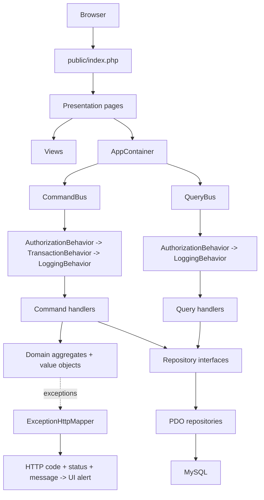

# JobVault

Job vacancy and user management system built with PHP + MySQL, featuring authentication, permissions, and a web UI.

## Overview
This project provides:
- Vacancy CRUD and job applications
- User CRUD
- Role/permission-based access control
- Authentication and sessions
- Activity logging
- Command and query buses with a behavior pipeline (authorization, transaction, logging)
- Centralized exception-to-HTTP/status mapping for UI feedback

## Structure and architecture
Layered (Clean Architecture / DDD-inspired). Dependencies only point inwards:
`Presentation -> Application -> Domain` and `Infrastructure -> Application/Domain`.

- `app/Domain` - pure PHP, no framework/SQL/HTTP. One folder per aggregate:
  - `Vacancy/` - `Vacancy` (publish, revise, open/close, `receiveApplicationFrom()`), `VacancyStatus` enum, `VacancyTitle`, `VacancyDescription`, `VacancyFilter`
  - `JobApplication/` - `JobApplication` (created only through an open vacancy), `AlreadyAppliedException`
  - `User/` - `User` (register, verifyPassword, changeProfile, changePassword, assignRole), `EmailAddress`, `PersonName`, `PlainPassword`, `PasswordHash`, `UserFilter`
  - `Role/` - `Role` (rename guard for admin, grant/revoke permissions, `ensureCanBeDeleted()`), `RoleName`
  - `Permission/` - `Permission`, `PermissionName` (`module.action` composition/normalization)
  - `Shared/` - typed ids (`AbstractId`), `PageRequest`, `SearchTerm`; `Exception/` - domain exceptions
  - Repository interfaces live next to their aggregate and expose intent methods (`matching(filter, page)`), never SQL.
- `app/Application` - use cases:
  - `Commands/`, `Queries/`, `Features/` (one handler per use case, calling the domain + repositories)
  - `Security/` - `Authorization` (role -> permissions, cached per request), `MessageAuthorizer` (the only place
    that decides if a command/query can run), `CurrentUserProvider`
  - `Auth/AuthService` - login/logout/sign-up, no HTTP (`header()`/`exit` stay in Presentation)
  - `Users/UserRegistrar` - unique e-mail + default role policy shared by sign-up and admin panel
  - `Ports/` - `SessionInterface`, `LoggerInterface` implemented by Infrastructure
  - `DTOs/` - read models returned to the UI
- `app/Infrastructure` - `Persistence/` (PDO `Database` wrapper + repositories), `Http/NativeSession`,
  `Logging/FileLogger`, `Container/AppContainer` (composition root)
- `app/Presentation` - `pages/` (thin controllers), `views/`, `Support/` (`PageAccess`, `Layout`, `Csrf`,
  `HttpRedirect`, `Pagination`, `ExceptionHttpMapper`, `StatusAlertMapper`)
- `public/index.php` - front controller (routes via `?r=`), starts the session before any output

## Architecture diagram


## Methodologies and patterns
- Rich domain model: business rules live in aggregates and value objects (invalid objects cannot be created)
- CQRS-lite: commands change state, queries return DTOs/`PagedResult`
- Ports & adapters for session, logging and persistence
- Single authorization enforcement point in the bus pipeline
- Exception-driven error flow with centralized HTTP/status mapping

## Main routes
- `index.php?r=home` (vacancies)
- `index.php?r=vacancies`
- `index.php?r=vacancies/new`
- `index.php?r=vacancies/edit&id=<uuid>`
- `index.php?r=vacancies/delete&id=<uuid>`
- `index.php?r=vacancies/apply`
- `index.php?r=users`
- `index.php?r=users/new`
- `index.php?r=users/edit&id=<uuid>`
- `index.php?r=users/delete&id=<uuid>`
- `index.php?r=login`
- `index.php?r=logout`

## Error handling and front feedback
Application and infrastructure errors are mapped to a normalized payload:
- `httpCode` (HTTP response code)
- `status` (URL-friendly status used by the UI)
- `message` (user-facing message)

Core mapper:
- `app/Presentation/Support/ExceptionHttpMapper.php`

Alert dictionary:
- `app/Presentation/Support/StatusAlertMapper.php`

Common statuses:
- `success`
- `error`
- `conflict`
- `not_found`
- `validation_error`
- `forbidden`
- `unauthorized`
- `db_error`
- `server_error`

Pages redirect with:
- `?status=<status>&message=<urlencoded-message>`

Database layer (`app/Infrastructure/Persistence/Exceptions`) throws dedicated exceptions:
- `DatabaseConnectionException`
- `DatabaseQueryException`

## Run with Docker
```bash
cp .env.example .env
docker compose build
docker compose up -d
```

Open: `http://localhost:8080/index.php?r=home`

> The database is initialized from `setup.sql` on first start. The container entrypoint runs
> `composer install` and creates `logs/` on every start, so the bind-mounted project always has a complete `vendor/`.

### Rebuild from scratch (remove image and containers)
```bash
docker compose down --rmi local      # stop/remove containers, network and the project image
docker compose build --no-cache      # rebuild the image ignoring the layer cache
docker compose up -d                 # create and start fresh containers
```

To also reset the database (deletes the `mysql_data` volume, so `setup.sql` runs again):
```bash
docker compose down --rmi local -v
docker compose up -d --build
```

> Without `-v` the MySQL data is kept and `setup.sql` is **not** executed again.

Check status and logs:
```bash
docker compose ps
docker compose logs -f php
```

### First admin user
`setup.sql` creates no admin. Sign up on the login page, then promote the account:
```bash
docker compose exec mysql mysql -uappuser -papp_password myapp_db -e \
  "UPDATE users SET role_id=(SELECT id FROM roles WHERE name='admin') WHERE email='you@example.com';"
```

## Tests
- Everything (inside the container): `docker compose exec php ./vendor/bin/phpunit`
- Unit (domain, handlers, security, mapper): `./vendor/bin/phpunit --testsuite Unit`
- Integration (PDO repositories against MySQL, rolled back): `RUN_INTEGRATION=1 ./vendor/bin/phpunit --testsuite Integration`
- HTTP regression example: `./vendor/bin/phpunit tests/Integration/Presentation/UsersAdminHttpRegressionTest.php`
- Mapper unit test example: `./vendor/bin/phpunit tests/Unit/Presentation/ExceptionHttpMapperTest.php`

If PHP is not available locally, run tests with Docker:
```bash
docker run --rm -v "$PWD":/app -w /app php:8.3-cli ./vendor/bin/phpunit --testsuite Unit
```
